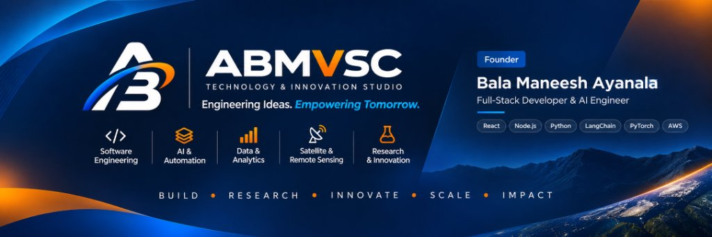

<div align="center">



<br/>

# ABMVSC Developer Portfolio Template

**A production-ready, fully customisable developer portfolio built by ABMVSC Technology & Innovation Studio.**

[](https://abms-portfolio.netlify.app/)
[](https://abms-portfolio.netlify.app/studio.html)
[](LICENSE)
[](.)

</div>

---

## What Is This?

This is a complete, **zero-dependency** developer portfolio template engineered by [ABMVSC Technology & Innovation Studio](https://abms-portfolio.netlify.app/studio.html).

It ships with two pages out of the box:

| Page | Route | Purpose |
|---|---|---|
| **Personal Portfolio** | `/index.html` | Your skills, projects, experience, research and contact |
| **Studio / Company Page** | `/studio.html` | Your agency, studio or company identity |

Both pages share one CSS system, one JS engine and one AI chatbot — fully connected.

---

## Features

- **AI Chatbot** — Context-aware assistant with streaming responses, telemetry badges and action buttons. Answers questions about you, your projects, skills and contact details. 34 trained intent rules.
- **Dual Page System** — Personal portfolio + company/studio page, linked together.
- **Zero Dependencies** — Pure HTML, CSS, JavaScript. No React, no Node, no build step.
- **Fully Responsive** — Mobile-first design. Works on every screen size.
- **Dark/Light Mode Ready** — CSS custom property system built for theme switching.
- **SEO Optimised** — Open Graph, Twitter Card, sitemap.xml, robots.txt, Google Search Console ready.
- **Favicon Package** — ICO, PNG 16/32, Apple Touch Icon, Android Chrome 192/512, PWA manifest.
- **Resume Modal** — PDF preview built in, no third-party viewer needed.
- **Quick Deploy** — Drag and drop to Netlify. No configuration required.

---

## Live Preview

| Portfolio | Studio |
|---|---|
| [abms-portfolio.netlify.app](https://abms-portfolio.netlify.app/) | [abms-portfolio.netlify.app/studio.html](https://abms-portfolio.netlify.app/studio.html) |

---

## File Structure

```
📁 your-portfolio/
│
├── index.html                   ← Personal portfolio page
├── studio.html                  ← Company / studio page
├── style.css                    ← Shared design system (CSS variables, components)
├── script.js                    ← AI chatbot engine + all JS logic
│
├── favicon.ico                  ← Browser tab icon
├── favicon-16x16.png
├── favicon-32x32.png
├── apple-touch-icon.png         ← iOS home screen icon
├── android-chrome-192x192.png   ← Android home screen icon
├── android-chrome-512x512.png
├── site.webmanifest             ← PWA manifest
│
├── og-image.png                 ← Social media preview card (1200×630)
├── photo.jpg                    ← Your profile photo
├── resume.pdf                   ← Your resume (opens in modal)
│
├── robots.txt                   ← Search engine crawl rules
├── sitemap.xml                  ← Sitemap for both pages
├── google[...].html             ← Google Search Console verification
│
└── assets/
    ├── abmvsc-hero-banner.jpg   ← Studio page hero image
    ├── abmvsc-logo-card.jpg     ← Studio logo card
    └── logo/
        ├── abmvsc-logo-primary.svg
        ├── abmvsc-logo-white.svg
        ├── abmvsc-logo-mono.svg
        ├── abmvsc-avatar.svg
        ├── abmvsc-symbol.svg
        ├── abmvsc-official-logo.svg
        └── abmvsc-official-logo-white.svg
```

---

## Quick Start — 4 Steps

### Step 1 — Clone or Download

```bash
git clone https://github.com/Balama2520/abmvsc-portfolio-template.git
cd abmvsc-portfolio-template
```

Or download the ZIP and unzip it.

### Step 2 — Replace Your Content

Open `index.html` and find the `<!-- PERSONAL DATA -->` sections. Replace:

```
YOUR NAME          →  your full name
YOUR ROLE          →  your job title
YOUR LOCATION      →  your city / country
YOUR EMAIL         →  your email address
YOUR PHONE         →  your phone number
YOUR LINKEDIN      →  your LinkedIn profile URL
YOUR GITHUB        →  your GitHub profile URL
```

### Step 3 — Update the AI Chatbot Brain

Open `script.js` and find the `brain` object (around line 50). Update every field with your real information:

```js
const brain = {
  name: "YOUR NAME",
  role: "YOUR ROLE",
  email: "your@email.com",
  phone: "+00 00000 00000",
  location: "Your City, Country",
  summary: "Your 2–3 sentence professional summary.",
  skills: "Your skill stack...",
  // ... all other fields
};
```

The chatbot will automatically answer every visitor question using this data.

### Step 4 — Deploy

**Netlify (recommended — free):**

1. Go to [app.netlify.com](https://app.netlify.com)
2. Click **Add new site → Deploy manually**
3. Drag your project folder onto the page
4. Done. Your site is live in 30 seconds.

**GitHub Pages:**

1. Push your code to a GitHub repository
2. Go to **Settings → Pages → Deploy from branch → main → / (root)**
3. Your site will be live at `https://yourusername.github.io/repo-name`

---

## Customisation Guide

### Colours

All colours are CSS variables in `style.css` at the top of the file:

```css
:root {
  --brand-navy:   #10264B;   /* Primary brand navy */
  --brand-dark:   #0B1220;   /* Deep background */
  --brand-blue:   #2563EB;   /* Technology interactions */
  --brand-orange: #FF7900;   /* Accent highlights */
  --cloud-white:  #F5F7FA;   /* Light backgrounds */
  --text-soft:    #64748B;   /* Muted text */
}
```

Change any of these values to match your brand.

### Typography

The template uses three fonts loaded from Google Fonts:

| Font | Usage |
|---|---|
| **Space Grotesk** | Headings and display text |
| **Inter** | Body copy |
| **IBM Plex Mono** | Technical labels and code |

Replace the `@import` in `style.css` to use different fonts.

### Chatbot Intents

The chatbot ships with 34 pre-built intent rules covering:

`greeting · summary · location · skills · projects · experience · education · research · achievements · contact · resume · pricing · devops · systemDesign · ragArchitecture · latencyOptimization · offlineArchitecture · cvPipeline · hiring · studio · hackathon · hobbies · joke · thanks · botInfo` and more.

To add a new intent, add an entry to `intentRules` in `script.js`:

```js
{ key: "yourIntent", words: ["keyword1", "keyword2", "phrase"] },
```

Then add the response in the `getAnswer` switch block:

```js
case "yourIntent":
  return brain.yourField;
```

### Studio / Company Page

`studio.html` is your company or agency identity page. Update:

- Company name, tagline and description
- Services and capabilities
- Product showcase cards
- Contact and collaboration CTAs

---

## SEO Setup

### robots.txt

```
User-agent: *
Allow: /
Sitemap: https://your-domain.com/sitemap.xml
```

Update the sitemap URL in `robots.txt` to your actual domain.

### sitemap.xml

Update both `<loc>` URLs in `sitemap.xml`:

```xml
<loc>https://your-domain.com/</loc>
<loc>https://your-domain.com/studio.html</loc>
```

### Google Search Console

1. Go to [search.google.com/search-console](https://search.google.com/search-console)
2. Add your domain as a property
3. Choose **HTML file** verification
4. Download the verification file and place it in your project root
5. Submit `sitemap.xml` after verification

---

## What to Replace / Remove

| File | What to update |
|---|---|
| `photo.jpg` | Replace with your own profile photo |
| `resume.pdf` | Replace with your own resume |
| `og-image.png` | Replace with your own 1200×630 social preview image |
| `favicon.*` | Replace with your own brand favicon (use [favicon.io](https://favicon.io)) |
| `google[...].html` | Replace with your own GSC verification file |
| `sitemap.xml` | Update both URLs to your domain |
| `robots.txt` | Update sitemap URL to your domain |
| `site.webmanifest` | Update name, short_name, theme_color |
| `index.html` | Replace all personal data |
| `studio.html` | Replace all company/studio data |
| `script.js` → `brain` object | Replace all data with your own |

---

## Browser Support

| Browser | Support |
|---|---|
| Chrome 90+ | ✅ Full |
| Firefox 88+ | ✅ Full |
| Safari 14+ | ✅ Full |
| Edge 90+ | ✅ Full |
| Mobile Chrome/Safari | ✅ Full |

---

## Performance

Built for speed — no frameworks, no heavy bundles.

| Metric | Target |
|---|---|
| First Contentful Paint | < 1.2s |
| Time to Interactive | < 2s |
| Lighthouse Performance | 90+ |
| Lighthouse SEO | 100 |
| Lighthouse Accessibility | 90+ |

---

## Licence

This project is released under the **MIT Licence**.  
You are free to use, modify and distribute it for personal and commercial projects.  
Attribution to ABMVSC is appreciated but not required.

See [LICENSE](LICENSE) for full terms.

---

## Built By

<div align="center">

**ABMVSC Technology & Innovation Studio**

*Engineering Ideas. Empowering Tomorrow.*

`BUILD · RESEARCH · INNOVATE · SCALE · IMPACT`

[Studio](https://abms-portfolio.netlify.app/studio.html) · [GitHub](https://github.com/Balama2520) · [Contact](mailto:contact@abmvsc.studio)

</div>
